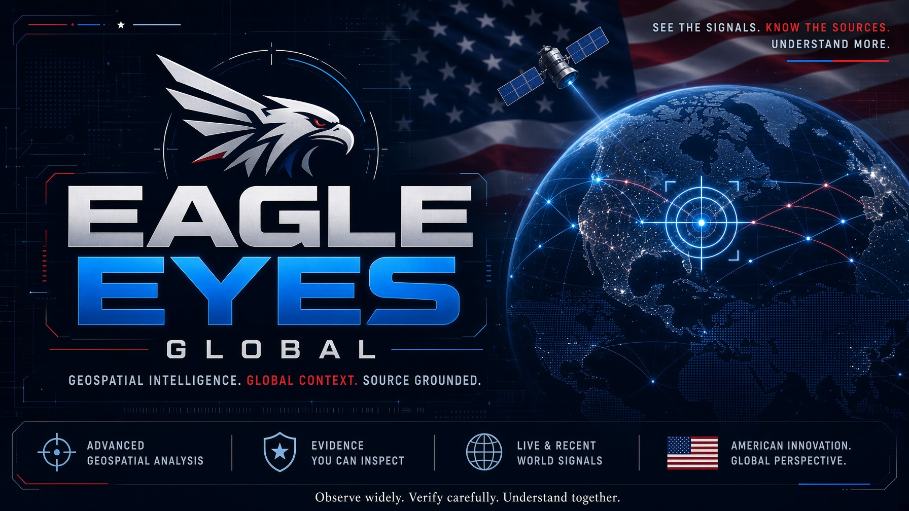

<div align="center">

# Eagle Eyes Global



### See the signals. Know the sources. Understand more.

An evidence-conscious geospatial workspace for humans and AI agents.

</div>

Eagle Eyes Global brings public world signals into one explorable 3D globe and
one read-only agent query surface. It is designed to support understanding, not
to turn an attractive map into false certainty. Source, retrieval time,
freshness, coverage, attribution, and limitations are part of the result.

The browser application includes public aircraft, vessels, satellites,
earthquakes, traffic, cameras, infrastructure, fires, and contextual layers.
The companion MCP adapter currently exposes bounded earthquake and wildfire
queries backed by USGS, NASA EONET, and NIFC WFIGS.

DISPLAY ▸ **Draw** creates bounded pins, routes, and areas directly on the globe
for temporary analysis and briefing markup.

Fifteen layers and map sources. **Thirteen have a keyless path.**

**Sits on the real ground.** Entity heights are aligned to work with Google 3D tiles, so aircraft park on aprons and cameras stand on street corners instead of floating.

## Truth contract

Every MCP observation carries an evidence envelope with source identity,
source record ID, observation and retrieval times, freshness, state, geometry,
attribution, license, limitations, and privacy class.

Empty results are never collapsed into a generic “nothing found.” The system
distinguishes:

1. observed zero;
2. source unavailable;
3. not covered;
4. not queried;
5. upstream never attempted.

Regional queries are capped at 500 km and 50 returned records. Source
truncation fails closed instead of silently claiming complete coverage. Agent
geometry is bounded; raw high-vertex fire rings are never embedded in an
evidence envelope.

The MCP surface is read-only. People are not a query type. Cameras are outside
the current adapter; any later camera source must be public, official, labeled,
and remain free of face, plate, person-tracking, and camera-control tools.

## Quick start

Requirements: Node.js 24.14+ (Node 24 LTS or Node 26 are the verified paths).

```bash
npm install
npm run doctor
npm run dev
```

Open `http://localhost:4173`.

The app starts without API keys using keyless map sources. Copy `.env.example`
to `.env`, or use Provider Settings in the app, to enable optional providers.
Browser-exposed Google/Cesium credentials must be restricted at the provider;
server-side credentials must never use a `VITE_` prefix. See
[`SECURITY.md`](SECURITY.md).

## MCP adapter

The adapter is deliberately separate from the browser runtime.

```bash
cd mcp-adapter
npm install
npm test
npm run probe:live   # optional; calls live upstream services
npm start
```

Tools:

- `get_source_status`
- `observe_region`

Current source IDs:

- `usgs_earthquakes`
- `nasa_eonet_wfigs_fires`

The green unit suite is deterministic and does not require live network
access. `probe:live` is an explicit integration check, not part of the default
test gate.

## Verification

```bash
npm test
npm run check:boundaries
npm run build
npm run qa:map-source-tray -- --keyless
```

The browser QA requires Chromium and outbound access to public map services.

## Compatibility during the rename

Eagle Eyes Global uses new product namespaces for package imports, browser
state, environment variables, cache/log directories, and debugging. Existing
browser state is imported once when no new-key value exists; subsequent writes
go only to the Eagle Eyes Global namespace. A read-only legacy browser debug
alias remains for one transition so existing local tooling can be updated
without creating two mutable stores.

Browser-state migration fails closed: if a legacy value cannot be copied into
the new namespace, the new shell does not keep consuming the old-owned key.
Cache and log directories are renamed rather than copied. Deliberately rolling
back to a pre-rebrand commit therefore starts that old version with a cold cache
and a reset local provider-budget file unless the directories are manually
renamed back first.

Internal `gev:` DOM event names and a few QA seams remain protocol identifiers
during this transition. They are not persistent storage keys or current product
branding; changing them would add coordination risk without isolating old and
new installations.

## Source lineage and license

Eagle Eyes Global is derived from Bilawal Sidhu’s MIT-licensed
[`God's Eye View`](https://github.com/bilawalsidhu/gods-eye-view). The original
author, license, commit history, and data-source obligations remain part of
this fork’s provenance. Renaming the product does not erase that gift.

See [`LICENSE`](LICENSE), [`DATA_SOURCES.md`](DATA_SOURCES.md), and
[`CONTRIBUTING.md`](CONTRIBUTING.md) before redistributing code, provider data,
or bundled third-party assets.
